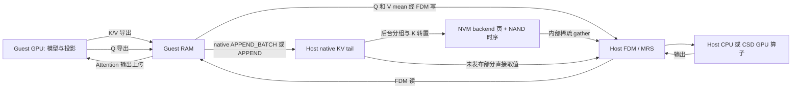

# 当前 native OPT / SparF 串行执行与数据流

审阅日期：2026-09-26。基于当前工作区，HEAD 为 `0972996d0d8d001f52d858e2bdbc0243e67b1f5e`，**包含未提交修改**，包括整阶段页去重、能力协商后的 `BUFFER_APPEND_BATCH` 和 native 启动路径。本文是代码走查，不是新一轮运行结果，也不据此声称论文性能已经复现。

**范围**：`--functional --attention-mode sparf --sparf-native --sparf-autonomous`，`batch-size == gpu-batch-size`，只有一个 microbatch。CSD 功能算子可以选 CPU 或 CUDA。旧文件/FIEMAP KV 路径、staged 三条 Guest Execute、多 microbatch 流水不作为本文主线。

这里的“串行”指一个 Decode 层等待本层 Attention 返回后才继续 Wo/MLP 和下一层。一次推理不是一条 NVMe 命令；一次 Attention 父 Execute 也不是一个 head。Prefill 写回、设备后台刷页，以及父 Execute 内部的目标读算重叠仍然存在。

约定：`B` 为本 microbatch 的 batch，`L` 为层数，`H` 为 OPT 的 head 数，`d` 为 head dimension，`P` 为 prompt 长度，`D` 为 Decode 迭代次数，`T` 为当前有效 KV 长度，`r` 为所选维度数，`k=ceil(T/compression_ratio)` 为所选 token 数。

## 1. 从哪里进入

| 层次 | 入口 | 做什么 |
|---|---|---|
| Host 启动 | [run-native-opt-test.sh](../../../femu-scripts/run-native-opt-test.sh) | 启动使用 `ftl_mode=instattention` 的专用 VM，配置 native NVM、buffer、CSD CPU/CUDA 和 Guest GPU |
| 另一 Host 入口 | [run-csd.sh](../../../femu-scripts/run-csd.sh)，`CEMU_FTL_MODE=instattention` 分支 | 当前也能启动 native 路径；要求一个 CSD、显式 Guest 镜像、可读配置和 NVM 文件 backend 目录 |
| Guest 命令 | [native-opt-guest-test.sh](../../../femu-scripts/native-opt-guest-test.sh) | 挂载模型目录、FDM，调用下面的 Python；当前脚本设置 `batch-size == gpu-batch-size`、两个 Attention slot |
| 应用入口 | [test_opt_cemu_pipeline.py](python/test_opt_cemu_pipeline.py)，`main()` | 解析配置，创建 NativeKvStore、CemuSparfDevice、slot scheduler、SparfGroupedAttentionBackend、模型 runner |
| 本次推理入口 | 同文件 `run_functional_pipeline()` | Prefill → Decode generation → terminal drain |
| 每层 Prefill | [runtime_common/prefill_runner.py](python/runtime_common/prefill_runner.py)，`ModelPrefillRunner.run()` | GPU 层计算、提交 KV writer、等待适当的 writer future |
| 每步 Decode | [runtime_common/generation.py](python/runtime_common/generation.py) → [decode_runner.py](python/runtime_common/decode_runner.py) | 自回归循环 → 每层 QKV、append、Attention、Wo/MLP |
| Attention 适配 | [sparf_attention.py](python/flexgen_adapter/sparf_attention.py)，`SparfGroupedAttentionBackend` | 类名仍叫 grouped，但 native 分支底层是 NativeKvStore；不要根据类名判断走了旧存储路径 |
| 设备父命令 | [cemu_sparf_device.py](python/cemu_flexgen/cemu_sparf_device.py)，`execute_autonomous()` | 向 compute namespace 提交一个 SparF workflow |
| Host 接收/执行 | [compute.c](../../../hw/femu/csd/compute.c)，`sparf_submit_autonomous()` / `sparf_autonomous_main()` | 持有 KV lease、排队进入 engine、驱动读/算/等待状态机 |

正式 Prefill 之前，`main()` 已打开存储/Attention backend、建立 FDM/MRS、加载程序，并调用 `preload_weights()`。`OptCheckpointLoader(cache_layers=True)` 把 embedding、所有层、final norm、LM head 权重预载到 Guest 模型设备。当前脚本使用 Guest CUDA。

因此后续每层虽然仍有 `load_layer()` / weight prefetch 调用，正常命中的是已缓存权重；**当前这条运行路径没有逐层从 CSD 读模型权重的 Weight Access 流水**。这些 setup 成本也不包含在 `pipeline.e2e_including_drain_wall` 内。

### 启动时先建立什么

1. Host 启动 QEMU，建立 native NVM 的 mapping、backend、tail 管理器和工作线程；Guest GPU 通过 VFIO 提供给 Guest。选用 CUDA CSD 时，Host 计算使用另外配置的 CSD GPU。
2. Guest 脚本运行 `test_opt_cemu_pipeline.py`，主线开关为 `--functional --attention-mode sparf --sparf-native --sparf-autonomous`；脚本设置 `batch-size == gpu-batch-size`、`--attention-slots 2`。
3. `NativeKvStore.open()` 通过 `/dev/ng0n1` 查询 INFO：确认设备身份、容量、计算支持和 APPEND 最大 payload。随后 BUFFER_REGISTER 发送任务/代际和 B/L/H/d、最大 token 数、dtype、页/分组几何、buffer 预算及后台 batch 页数。Host 据此建立每个 stream 的 ring 和前缀状态；各层共享这个 store。
4. 每个 Attention slot 的 `CemuDevice.open()` 打开 compute/control 设备，加载并激活 CPU 或 CUDA 功能程序，创建 11 个 FDM 文件及 MRS。文件按最大 T/k 容量分配，对齐后注册，不是每次 Attention 重新分配历史 KV。
5. `CemuClient.create_memory_ranges()` → Guest `cemu_create_mrs()` → `fdmfs_get_memory_range()`，把文件对应的 FDM 起点/长度交给设备。之后 Execute 使用 program ID、MRS ID 找到这些范围。
6. 预载权重，进入 `run_functional_pipeline()`。这时建立好的只是 KV 容器；prompt KV 由随后 Prefill 产生并追加。

`/dev/ng0n1` 是 namespace 字符设备的 passthrough 入口。当前 client 特意拒绝 block node，避免这套 Guest 内核的 block ioctl 路由到 compute namespace。namespace 1/2/3 分别承担 native KV、FDM、计算，不是三个名称指向同一条数据路径。

## 2. 数据分别在哪里

| 位置 | 保存什么 | 与其他位置的关系 |
|---|---|---|
| Guest GPU 显存 | 常驻模型权重、hidden、QKV 投影、Prefill Attention、Wo/MLP/LM head | KV/Q 导出经过 `.cpu().numpy()`；Attention 输出经过 `torch.as_tensor(..., device=...)` 返回 |
| Guest CPU 内存 | NumPy Q/K/V、V 的累计和/均值、APPEND 包、FDM 对齐 I/O 缓冲 | native ioctl 的 PRP 指向普通 Guest 内存；当前不是 GPU→CSD P2P |
| native KV tail，QEMU Host 堆内存 | 每个 `(batch, layer, head)` 尚未发布到 Flash 的原始 K/V | 由 BUFFER_REGISTER 分配，有预算；**不在 Guest FDM 文件/MRS 中** |
| native NVM namespace，Guest `/dev/ng0n1` | token-K、channel-K、token-V 三种布局的页 | 用任务/代际/坐标寻址，经 native mapping 分配 PPA；没有 Guest KV 文件或 FIEMAP |
| NVM backend | 用于保存模拟物理页字节的 Host backend / 文件映射 | Host 内存/文件访问负责功能数据，NAND 调度另外给目标完成时间；不是每页一次真实 NAND 操作 |
| FDM，Guest `/dev/nvme0m2` → `/mnt/fdm0` | Q、mean、读出的 K/V、概率、输出、trace 等暂存区 | Host 侧为 FDM backend 内存；文件只是 Guest 访问入口 |
| MRS（Memory Range Set） | 各 FDM 文件对应的内存范围描述 | 是寻址/授权集合，不是又复制一份张量的存储层 |
| compute namespace `/dev/ng0n3`，control `/dev/nvme0c3` | Execute、程序/MRS 管理 | Execute 携带元数据和 MRS ID，Q/mean 的大块数据先写到 FDM |
| 可选 Host CSD GPU 显存 | FDM 范围的 CUDA mirror，exact QK/PV 功能算子输入输出 | 与直通给 Guest 的 GPU 是不同角色；由 backend 做 Host RAM↔CUDA mirror 同步 |



图中 Flash→FDM 是设备内部调用，不重新经过 Guest NVMe 提交队列；也不是完整历史 KV 回传给 Guest。

## 3. Prefill：每层实际做什么

主要代码：[prefill_runner.py](python/runtime_common/prefill_runner.py)、[opt_runtime/ops.py](python/opt_runtime/ops.py)、[microbatch.py](python/flexgen_adapter/microbatch.py)。

1. prompt token IDs 进入 Guest GPU，计算 token/position embedding，得到 hidden。
2. 每层在 Guest GPU 做 LN、Q/K/V projection，Q 已乘 `1/sqrt(d)`；做完整 causal Attention：QK、mask、softmax、PV，再做 Wo、残差及下一段 LN。
3. `prefill_attention()` 返回本层 hidden/MLP inputs 和形如 `[P, B*H, d]` 的 K/V。**Prefill Attention 全在 Guest GPU，未调用 CSD SparF。**
4. `submit_prefill(layer, K, V)` 把本层 KV 写任务交给单 worker 的线程池。writer 把张量转为 Guest CPU NumPy，调用 backend `write_prefill()` → `_append()` → `NativeKvStore.append_batch()`。
5. GPU 主线程在提交本层写任务后等待上一层的 pending write，然后继续本层 MLP；下一层 Attention 可以与已有写任务存在重叠。最终 LM head 产生第一个生成 token，并等待最后一个 writer future。
6. `kv_writer.flush()` 收敛 Guest writer/backend 工作；native store 的 `flush()` 本身仅 `check_ready()`。最后同步 Guest GPU。

**Prefill 完成的真实含义**：所有 prompt KV 已被设备接收，GPU Prefill 完成；不能由此断言三种 KV 布局已全部发布到模拟 Flash。日志里的 “persist K/V to NVM” 不能替代这个实际完成条件。

### APPEND 下沉到哪里

代码：[native_kv_store.py](python/cemu_flexgen/native_kv_store.py)、[native_kv_client.py](python/native_kv_client.py)、[instattention_native.c](../../../hw/femu/bbssd/instattention_native.c)、[instattention_buffer.c](../../../hw/femu/bbssd/instattention_buffer.c)。

```text
Guest GPU K/V
  → Guest CPU contiguous NumPy
  → token tile 外层，同一 batch/layer 的多个 head 合成一包
  → ioctl(/dev/ng0n1, BUFFER_APPEND_BATCH, 坐标与 token/head 数)
  → QEMU NVMe SQ → bb_native_submit → native_worker → native_execute
  → PRP 数据读入 Host wire buffer → native_kv_buffer_append_batch
  → 检查这一包所有 head 的前缀、reader 和容量 → 复制进原始 K/V ring
  → accepted 前缀前进 → CQ 完成 → Guest ioctl 返回
```

**当前默认协商路径**：设备支持时使用 `BUFFER_APPEND_BATCH=0xD1`，payload 上限取设备能力、client 的 128 KiB 上限和可选请求上限的最小值。包内先放全部 K，再放全部 V，各自形状为 `[heads,tokens,d]`；不再给每个 head 补齐 4 KiB。同一包不能跨 batch/layer。

FP16、`d=128` 时，一个 token/head 的 K+V 是 512 B。128 KiB 上限下，Prefill 取 16-token tile，每包最多 16 heads；Decode 单 token 时可把同一 batch 的 40 heads 放进一个 20 KiB 包。Guest 仍逐包同步提交。

命令字段定义见 [native_kv.h](../../../include/hw/femu/native_kv.h)：CDW10 为版本/本包 token 数，CDW11/12 为 task/generation，CDW13 为 batch/layer，CDW14 为 first-head/head-count，CDW15 为首 token。Guest `LinuxTransport.__call__()` 将 payload 放入普通 Guest 内存，构造带 addr/data_len 的 passthrough 结构；Guest NVMe 驱动将其映射成 PRP。这里的 PRP 是 Guest 内存地址描述，不是 Guest GPU 显存的 P2P 映射。

Host 在 buffer 锁内先检查**整包全部 head**，全部可写才复制并推进 accepted；任何 head 有 reader、K/V ring 剩余容量不足，就整包返回 pending，不推进其中一部分 head。Guest 等待 100 μs 后重试，当前背压总超时为 120 s。一次 `append_batch()` 可以由多个命令组成，整个 Python 调用不是跨命令事务；后续命令失败时会把 session 标为失败，不回滚此前已接收的包。

旧设备不报告批量能力或请求上限为 0 时，才回退到 `BUFFER_APPEND=0xCD`：stream 外层、8-token tile 内层，每包补齐 4 KiB，Decode 也每 head 一包。**旧版的固定 4 KiB 命令数不能继续描述当前默认路径。**

成功 APPEND 的 CQ 路径会加传输目标延迟，但不等待后台 NAND 写完；buffer 预算和 ring 容量也不会因为 wire payload 从 4 KiB 增大到 128 KiB 而自动放大。统计时成功命令和重试必须分开。

adapter 的 stream 编号通过 `_coordinate()` 转成 `(batch,layer,head)`；设备内部再使用自身的 stream 展平方式。不要把 Guest 的线性 stream ID 直接当 PPA 或 Host 数组下标。

`_append()` 成功后，Guest CPU 还把 V 转为 float64 累加 `_mean_sum` / `_mean_count`。这是之后 SparF mean 修正的来源。当前 `prefill.grouped_append_wall` 和 `decode.grouped_append_wall` **包含张量导出、打包、所有 ioctl/背压以及 mean 更新**，并非纯 NVMe 传输时间。

### APPEND 逐包展开：4 个 20 KiB 包的由来及完成语义

以一个 Decode 层、`B=4,H=40,d=128,FP16`、新 token 位置 1024 为例。`_kv()` 将 GPU 数据导出为 `[1,4,40,128]`，`_append()` 再 reshape 成 store 接收的 `[1,160,128]`。stream 维在这一层内按 batch→head 展开。每个 head 的 K 为 256 B，V 为 256 B，共 512 B。

`_append_heads()` 的循环先选 token tile，再选 head 区间。token tile 上限是 `min(token_group_tokens, payload_limit / 每个 head-token 的 K+V 字节)`；对本例是 16，但输入只有 1 token，所以 count=1。heads 取“当前 batch/layer 剩余 heads、输入剩余 streams、payload 能装下的 heads”三者最小值：`min(40,160,131072/512)=40`。后续包同理。

| 包 | batch / layer / heads / tokens | K 区 | V 区 | payload |
|---|---|---:|---:|---:|
| 0 | batch 0，本层，head 0..39，token 1024 | 10,240 B | 10,240 B | 20,480 B |
| 1 | batch 1，其余同上 | 10,240 B | 10,240 B | 20,480 B |
| 2 | batch 2，其余同上 | 10,240 B | 10,240 B | 20,480 B |
| 3 | batch 3，其余同上 | 10,240 B | 10,240 B | 20,480 B |

虽然合计 80 KiB 小于 128 KiB，目前 ABI 只有一个 batch/layer 坐标，client/Host 也限制不得跨它们，所以不是一个 80 KiB 包。4 个包逐个执行阻塞 ioctl；每包成功并更新 Guest `_accepted` 后才发送下一包。一个包的格式是所有 head 的 K 在前、所有 head 的 V 在后，并非 `K0,V0,K1,V1` 交错排列。多 token 时每个 head 内依次排列该 tile 的 token 和 d 维元素；这是传输布局，还不是 channel-K 的 NAND 布局。

以 layer 7、batch 0 的第一包为例，opcode=`0xD1`、nsid=1，字段为：

| 字段 | 值/含义 |
|---|---|
| CDW10 | `1 | (1 << 16)`：版本 1，本 head 区间各追加 1 token |
| CDW11/12 | 本次注册的 task / generation |
| CDW13 | `0 | (7 << 16)`：batch 0、layer 7 |
| CDW14 | `0 | (40 << 16)`：first head 0、head count 40 |
| CDW15 | 1024：新数据从 token 1024 开始 |
| ioctl addr/data_len | Guest 用户缓冲地址 / 20,480 B |

`LinuxTransport` 每次尝试创建 ctypes buffer 并复制 packet，构造 72 B 的 ioctl 参数结构。这个结构不是 20 KiB 数据本身，也不是原样写入 SQ 的 NVMe 命令。Guest `nvme_user_cmd()` 复制命令字段，`nvme_submit_user_cmd()` 映射用户缓冲并同步执行，PCI 驱动构造 PRP 后提交 SQ。PRP 描述 Guest 内存页；一条 20 KiB 请求可以覆盖多个内存页，不因此拆成五条 APPEND，也不能把 PRP 页数直接当成 NAND 页数。

Host 从 SQ 取命令时记录 `stime=clock_ns()`，进入 native worker。Host 根据注册的 d/元素大小及命令里的 token/head 数计算 `transfer_bytes=2*count*heads*d*element_bytes`，验证上限/MDTS，再用 `dma_write_prp()` 将 payload 拷入临时 wire buffer。随后才进入 tail 检查和 memcpy。

tail 是每个 stream 的环形数组。`accepted=1024` 表示 `[0,1024)` 已接收，下一个合法追加位置为 1024；它不是最后一个 token 的下标。追加一个 token 后变为 1025。FP16/d128/C8 几何下 K ring 容量 512 token、V ring 容量 32 token，写入地址分别按 `token % 512` / `token % 32` 取槽，但只有旧数据已安全写回才允许覆盖。

容量检查实际上是：

```text
K 占用 = accepted - min(token_K_committed, channel_K_committed)
V 占用 = accepted - token_V_committed
新增 count 必须同时不超过 K、V 的剩余容量，且 readers == 0
```

前缀不匹配是错误，不会用 pending 无限重试；reader 占用或容量不足才返回 pending。整包任一 head 不满足条件，所有 head 都不复制到 tail。全部通过后，Host 逐 head/token 将包内 K/V 复制到各自 ring、推进 accepted、把可写组放入 ready 队列并唤醒后台 worker。

**pending 也已经发生一次 Guest→Host wire buffer 的 payload 拷贝**，因为容量检查在 PRP 取数之后。client 对 `status=0xC,result=5` 等待请求的 100 μs 再重新 ioctl；实际恢复受调度影响，并非保证精确 100 μs。单 ioctl 设置 10 s timeout，单包 pending 重试循环的期限是 120 s。当前 pending 将 `data_size/pcie_lat` 设为 0，没有按这些已执行的拷贝计入成功包的 PCIe 目标模型。

成功 APPEND 的 `deadline` 仍为请求的 `stime`，没有增加 NAND latency。CQ 路径另按以下规则计算传输目标时间：

```text
trans = max(10 ns, payload_bytes / configured_pcie_bandwidth)
rx_next = max(old_rx_next, request.stime) + trans
request.expire = rx_next + propagation_delay
```

实际还要等 native worker 把请求送到 poller、当前虚拟时间达到 expire、Guest CQ 有空间，才发布完成项。**不是在 tail memcpy 完成后再额外睡完整 trans 时间**；若功能处理耗时已经跨过目标 deadline，poller 不会重新补等同样的时间。Guest 随后处理 CQ，内核同步调用返回 status/result，client 才推进本地 `_accepted`。

因此成功保证本包已被接收，可通过设备 Flash/tail 组合路径读取；不保证“此时仍全部只在 tail”，因为后台可能已经写回部分数据，也不保证三种 NAND 布局都完成。传输命令分包不决定 NAND 页分组：20 KiB APPEND 的 40 份 K/V 分散进 40 个 stream ring，各自按 token/channel 组条件写回，不是直接 program 五个连续页。

4 个包不是一个事务：若包 0/1 成功、包 2 pending，只重试包 2，包 3 尚未发送；若包 2 最终报错，前两个包不会回滚，session 标为失败。四包全成功后，adapter 才更新这一层全部 batch 的 V mean，然后继续 Attention。不能把一个单包 CQ 成功理解为本层全部 160 heads 都已完成追加。

### 设备后台如何变成三种页

每个 stream 有一个 K ring、一个 V ring。K ring 同时供 token-K 与 channel-K 写回使用，回收进度受两者较慢的一方限制。

以 4 KiB 页、FP16、`d=128`、`channels_per_page=8` 为例：

| 持久布局 | 一个页/组保存什么 | raw tail 的容量 |
|---|---|---|
| token-K | 每页 16 个 token，每 token 完整 128 维 | K ring 512 token，供两种 K 布局共享 |
| channel-K | 每页 8 维 × 256 token；完整 128 维需 16 页一组 | 同上；后台 pack 时转成维度连续的布局 |
| token-V | 每页 16 个 token，每 token 完整 128 维 | V ring 32 token |

`buffer_worker()` 的过程：ready 队列 → `pack_batch()` 复制/转置/补零 → `bb_native_kv_batch(write)` → mapping/PPA → backend 写真实字节并安排 NAND 目标时间 → 等目标 deadline → 分别推进三类 `committed` 前缀 → 允许旧 ring 位置复用。

`batch_pages` 是批次上限，并不保证每次都有这么多页。这个 worker 等当前批次目标完成后才发布并处理下一批。APPEND 接收完成、backend 字节已写、目标 NAND 完成、committed 发布是不同事件。

PPA 分配入口为 [instattention_mapping.c](../../../hw/femu/bbssd/instattention_mapping.c) 的 `cemu_kv_map_reserve()`；页 I/O 为 [instattention_io.c](../../../hw/femu/bbssd/instattention_io.c)。`cemu_kv_io_write()` 先 reserve 页、复制到 I/O scratch，调用 schedule 安排 NAND 目标 deadline，再把字节写 backend、登记写结果；buffer worker 等 deadline 到达后才发布 committed。读写共享 NAND/LUN 调度状态，读已写页还会遵守其写完成依赖。

### 谁在执行，谁在等待

| 执行者 | 工作及与主线的关系 |
|---|---|
| Guest 模型主线程 | 运行 GPU 模型；Decode 当前层同步等待 `run_decode(...).result()`，此时不会进入下一层 |
| Guest Prefill writer，单 worker | 导出并追加 KV、更新 mean；可与模型 GPU 工作重叠，结束时由主线程 join |
| Guest Attention slot 的 load / autonomous / store workers | 分别写 Q/mean、阻塞提交 Execute、回读输出/trace；两个 slot 提供容量，不使单 microbatch 主线自动并发 |
| Guest 内核 NVMe 驱动 | 把 passthrough 或 FDM I/O 转成命令、映射 PRP、提交 SQ、接收 CQ 唤醒调用者 |
| Host NVMe poller | `nvme_process_sq_io()` 读取 Guest SQ，创建请求并分派；`nvme_process_cq_cpl()` 在目标完成时间到达后向 Guest CQ 写完成项 |
| Host native worker | 从 `to_ftl` 接收 native 命令，处理 INFO/REGISTER/APPEND/DRAIN 等，完成后入 `to_poller` |
| Host buffer worker | 独立处理凑齐的组或 drain 残组；pack、写页、等待 NAND deadline、发布 committed；不需要 Guest 再发一条普通 NVMe Write |
| Host SparF autonomous worker | 从 engine 队列取得父 Execute，推进选择、内部 gather、功能计算和各阶段等待 |
| Host CU scheduler | 调度 approximate/exact/PV 的内部目标计算任务，将完成事件送回父 workflow；它们不是 Guest 新发的三个 Execute |

SQ/CQ 是 Guest 与虚拟控制器之间的 NVMe 队列；`to_ftl`、`to_poller`、autonomous queue 和内部 completion ring 是 QEMU 内部队列，不能把这些队列切换都记成一次外部 PCIe 张量传输。

## 4. 一个 Decode step：从一个 token 到下一个 token

入口为 `ModelGenerationRunner.run()`。第 0 步输入 Prefill 产生的 token，位置 `P`，有效 KV 长度为 `P+1`。第 `s` 步位置 `P+s`，`T=P+s+1`。

| 顺序 | 执行位置 / 入口 | 数据流与完成条件 |
|---|---|---|
| 1 | Guest GPU，`embed()` | 输入 token → hidden |
| 2 | 每层 `prepare_decode_attention()` | LN/QKV；Q 为 `[B,H,d]`，K/V 为 `[1,B*H,d]`；Q 已缩放 |
| 3 | `append_decode()` | 本 token K/V：GPU→Guest CPU→native tail；全部 head 接收完成后更新 V mean，继续本层 Attention |
| 4 | `_decode_args()` | Q：GPU→Guest CPU；从累计和生成覆盖当前 accepted 前缀的 V mean；还会做 NumPy copy |
| 5 | slot scheduler → `_prepare_decode()` | Q 写 MR0、mean 写 MR4；计算 `k` 和三段目标 runtime，打包 native task/generation/layer/T 等 metadata |
| 6 | `execute_autonomous()` | 提交一个父 Execute，Guest 线程等待整个 SparF workflow 完成 |
| 7 | `_collect_decode()` | 从 FDM MR9 读输出到 Guest CPU；再从 MR10 读 trace；释放 slot/future |
| 8 | Guest GPU，`finish_decode_attention()` | 输出 CPU→GPU，reshape、Wo、残差、LN |
| 9 | Guest GPU，`run_mlp()` | FC→ReLU→FC→残差，得到下一层输入；重复步骤 2–9 |
| 10 | Guest GPU，`run_output_head()` | 最后一层后 final norm、LM head、argmax/采样，产生下一次迭代的输入 token |

当前 backend `supports_pipelined_decode=False`；上述单 microbatch 分支直接 `append_decode()` 后 `decode()`。slot scheduler 内部有准备/Execute/收集线程，但 `run_decode()` 是 `submit_decode(...).result()`，父请求结束才返回调用方。因此两个 slot 或两个 engine 不自动形成两个并发父 Attention。

一次父 Attention 覆盖这一层的全部 `B*H` 个 query vector。例如 `L=40,D=16`，单 microbatch 是 **640 个父 Execute**，不是 640×B×H 个。

`D` 次循环处理了 `D` 个新 token 的 KV，结束时每层前缀为 `P+D`。generation 返回值还包含 Prefill 产生的初始 token 和最后一次 Decode 新预测的 token；最后这个预测 token 尚未再次经过模型追加 KV。因此不要直接把返回 token 数量当 APPEND 次数。

## 5. 一个父 Execute 内部怎样完成 SparF

主状态机：[sparf_workflow.h](../../../hw/femu/csd/sparf_workflow.h) 的 `run_sparf_workflow()`；驱动器：[compute.c](../../../hw/femu/csd/compute.c) 的 `sparf_autonomous_main()`。

接收时先校验 program/MRS 和 native 坐标，`native_kv_attention_open()` 获取当前层、当前 batch 前缀的 lease，保证这些 KV 在 Attention 期间可访问，再排队进入自治 engine。接收要求相关 stream 的 accepted 与本次 T 对齐，**不会先 drain 所有 KV**。lease 增加 reader 计数，在父 Attention 结束前阻止这些 stream 再 append；后台写回仍可推进，具体 gather 持锁时与它互斥。

这条控制路径是 `execute_autonomous()` → Python/C++ binding → `CemuClient.execute()` → `ioctl(/dev/ng0n3, NVME_IOCTL_IO_CMD)` → Guest SQ → Host `program_execute()` → `sparf_submit_autonomous()`。Execute 携带 program/MRS ID、workflow 标识和 metadata：task/generation、batch 起点、layer、T、B/H/d、dtype、r/k 和三段 runtime budget；**不再携带完整 Q/K/V**。Host 通过 PRP 复制 metadata，持有 program/MRS 引用，把 `storage_read` 绑定为 native 内部读函数，再把父 job 放到 autonomous queue。engine worker 取出后运行 `sparf_autonomous_main()`。

| 阶段 | 功能执行及数据流 | 后续等待 |
|---|---|---|
| A. 选择 Q 维度 | Host CPU 读取 MR0，按 `abs(Q)` 排序，每个 vector 选 top-r；索引留在 Host 工作数组 | 随后发起 channel-K gather |
| B. 读 channel-K | 从 native NVM 页/原始 K tail 取选中维度的全部 `T` 个 token，写入 MR1 `[B*H,r,T]` | 等 channel-K 的目标读 deadline |
| C. 近似筛选 | Host CPU：按选中维度算近似 logits，做 L1 范数比例修正、softmax、token top-k；强制包含当前 token；所选概率求和得到 alpha，写 MR7 | 调度并等待 approximate 的目标计算预算 |
| D. 读 token-K | 用所选 token 索引取完整 d 维 K，写 MR2 `[B*H,k,d]` | 等 token-K 目标读 deadline |
| E. 读 V 并计算精确 QK | 先启动所选 token-V 的内部 gather 写 MR3；再用 MR0/MR2/MR7 调 exact QK+softmax，写 MR8 | exact QK 的目标计算与 token-V 的目标读取可重叠 |
| F. 补 mean / 等 V | MR4 的 mean 复制到 MR3 每个 vector 的第 `k+1` 行；MR8 对应额外概率为 `1-alpha` | 若 token-V deadline 尚未达到，继续等 |
| G. PV | MR8 × MR3 → MR9 `[B,H,d]`，结果包含 mean 修正项 | 调度并等待 PV 的目标计算预算 |
| H. 父命令完成 | 写 trace，结束 workflow，释放 native lease 和相关引用，CQ 返回 | Guest 才开始读取 FDM 输出/trace |

精确分支用 alpha 缩放所选 token 上的精确 softmax，PV 再加 `(1-alpha)*mean(V)`。这里 mean 是 Guest 维护并每次传入的完整 accepted 前缀均值。

CPU target 用 Host CPU `.so` 完成 exact QK/PV；CUDA target 使用 [sparf_attention_devptr.cu](../kernel/sparf_attention_devptr.cu) 在 Host CSD GPU 上完成这两段。**CUDA target 并未把 A/C 的选择、近似 softmax、top-k、alpha 求和全部搬到 GPU**；它们仍在 Host C 状态机里执行。

### 内部 gather 具体从哪里读

调用链：[instattention_attention.c](../../../hw/femu/bbssd/instattention_attention.c) `native_kv_attention_read()` → [instattention_buffer.c](../../../hw/femu/bbssd/instattention_buffer.c) `native_kv_buffer_gather_phase()` → [instattention_device.c](../../../hw/femu/bbssd/instattention_device.c) `bb_native_kv_batch()`。

1. 把全部选中维度/token 转为 native ranges，检查 accepted 前缀。
2. 在 buffer 锁内，按每种布局的 committed 边界划分数据来源。已发布部分读 Flash 页；未发布部分直接读 raw tail。三种布局的边界可能不同。
3. 最新实现对**整个读取阶段**建立页片段计划并去重，同一页即使服务多个 range 也只读一次；然后按 `batch_pages` 分批读取并 scatter 回原顺序。没有跨 Attention 的读缓存。
4. 每批调用实际 mapping/backend/NAND 模型；批次使用同一个阶段 start，最终 ready 取所有实际调度 deadline 的最大值。总耗时不是简单“批数×单批延迟”。
5. 记录真实读取页数/Flash bytes、tail bytes 和批数；临时计划也检查注册内存预算。当前规划、读取、scatter 仍持有 buffer 锁。

**功能执行上的关键区别**：native `storage_read()` 在当前 Host 调用里同步完成 backend 取数和 scatter，返回时 MR 字节已经填好；随后状态机才在目标时间轴上等待数据可用。E 阶段的真实 V gather 先于真实 QK 功能调用完成。因此“QK/V 重叠”当前指目标时间上的重叠，不能据此声称 native backend 读取与 CUDA kernel 在真实 Host 时间上并发。

### FDM 各范围的用途

以下是逻辑有效形状，实际分配按最大序列长度/最大 k，并做对齐：

| MR | 数据 | 写入者 → 使用者 |
|---|---|---|
| 0 | Q `[B,H,d]` | Guest → top-r、exact QK |
| 1 | channel-K `[B*H,r,T]` | native gather → Host 近似筛选 |
| 2 | selected-K `[B*H,k,d]` | native gather → exact QK |
| 3 | selected-V + mean `[B*H,k+1,d]` | native gather + Host 补 mean → PV |
| 4 | V mean `[B,H,d]` | Guest → MR3 的末行 |
| 5、6 | current-K、current-V | native 路径不再通过这两段上传；当前 KV 已经走 APPEND |
| 7 | alpha，FP32 `[B*H]` | Host 近似筛选 → exact softmax |
| 8 | probability，FP32 `[B*H,k+1]` | exact QK/softmax → PV |
| 9 | Attention 输出 `[B,H,d]` | PV → Guest CPU → Guest GPU |
| 10 | workflow trace | Host 状态机 → Guest profiler |

FDM 数据传输入口为 [guest/cemu_client.cpp](guest/cemu_client.cpp) 的 `write_range()` / `read_range()`，使用对齐缓冲和 `pwrite/pread`。Guest fdmfs 经 direct I/O、CEMU block device 转为 NVMe memory 命令，Host 在 [memory.c](../../../hw/femu/csd/memory.c) 中处理。CUDA target 还可能在 [backend.c](../../../hw/femu/backend/backend.c) 的 `backend_cuda_prepare_device/host()` 触发 FDM mirror 同步。因此 output read 可能包含 Host CSD GPU→Host RAM 的搬运；不是只包含 Host RAM→Guest RAM。

### 每次跨边界具体怎么搬

| 次序 / 数据 | 从哪里 → 到哪里 | 搬运机制、入口及返回条件 |
|---|---|---|
| 1. 本层新 K/V | Guest GPU → Guest NumPy | adapter `_kv()` 使用 `.detach().contiguous().cpu().numpy()`，由 PyTorch/CUDA 完成 GPU→CPU 数据拷贝；数据可在 CPU 使用后打包 |
| 2. APPEND payload | Guest NumPy → Guest ioctl buffer → Host wire buffer → Host tail | transpose/tobytes 和 ctypes 建包；驱动映射 PRP；`native_execute()` 的 `dma_write_prp()` 读 Guest 地址；buffer 函数 memcpy 到各 head ring；接收并到达 CQ 完成条件后 ioctl 返回 |
| 3. 满组或 drain 残组 | Host tail → batch scratch → 页 I/O scratch → Host NVM backend | `pack_batch()` 复制/转置，`bb_native_kv_batch()` → `cemu_kv_io_write()` → `native_page_transfer()` → `backend_rw_internal_checked()`；字节写与 NAND 目标完成分离 |
| 4. Q / mean | Guest GPU Q / Guest CPU mean → Guest 对齐 I/O buffer → Host FDM MR0/MR4 | `_decode_args()` 导出 Q/构造 mean；`write_tensor()` → `write_range()` → FDM `pwrite()`；Guest 内核生成 ns2 memory write，Host PRP copy 写 FDM |
| 5. Execute metadata | Guest metadata buffer → Host 请求 data_buffer | compute ns3 passthrough，Host `program_execute()` PRP copy；MRS ID 引用已经存在的 FDM 张量，不再次上传它们 |
| 6. channel-K / selected K,V | Host NVM backend 页及 Host tail → Host FDM MR1/MR2/MR3 | native 内部函数直接读页、取 tail 并 scatter；无需 Guest 发 Read，不把历史 KV 绕回 Guest |
| 7. 选择与近似计算 | FDM Q/channel-K → Host 工作数组 → alpha MR7 和所选索引 | Host C 代码读写、dtype 转换、排序/点积/softmax；channels、token 索引、scores 等是工作数组，不是全部另建 MRS |
| 8. exact / PV，CUDA target | Host FDM RAM ↔ Host CSD GPU mirror | `backend_cuda_prepare_device()` 同步脏输入后运行 kernel；输出标记 device dirty。exact 使用 MR0/2/7/8，PV 使用 MR8/3/9；按数据脏状态同步，不必每个 MR 每次全量往返 |
| 9. mean 补行 | Host FDM MR4 → MR3 的额外一行 | Host memcpy；PV 同时消费 selected V 和 mean，概率最后一项为 `1-alpha` |
| 10. Attention 输出 | MR9 的 GPU mirror（若有）→ Host FDM RAM → Guest I/O buffer → Guest NumPy | Execute 返回后 `_collect_decode()` → `read_tensor()` → `pread()`；Host `memory_read()` 先 prepare_host，再 `dma_read_prp()` 写 Guest 内存；另读 MR10 trace 后 future 完成 |
| 11. 模型继续 | Guest NumPy 输出 → Guest GPU | `finish_decode_attention()` 的 `torch.as_tensor(..., device=...)` 上传，然后 Wo/残差/LN/MLP |

第 4/10 项的完整内核链：`fdmfs` 的 direct I/O → `cemu_bdev_submit_bio()` 标记 `BIO_NVME_MEMORY_CMD` → Guest [pci.c](../../../../linux-cemu/drivers/nvme/host/pci.c) 把请求改写为 ns2、按字节地址的 memory write opcode 5 / memory read opcode 2 → 常规数据映射与 NVMe 提交。相关内核文件还有 [fdmfs/file.c](../../../../linux-cemu/fs/fdmfs/file.c)、[host/cemu.c](../../../../linux-cemu/drivers/nvme/host/cemu.c)。

`dma_write_prp` / `dma_read_prp` 的名字以设备写入/读出为背景；这里分别实现 Guest 内存→Host backend、Host backend→Guest 内存的模拟 DMA 数据访问。它们不意味着两块实际 GPU 已建立直接 DMA 通路。CPU target 则直接在 Host RAM 上运行 exact/PV，不经过第 8 项的 CUDA mirror。

### 把一个具体请求展开

取脚本常用形状 `B=4,H=40,d=128,FP16,P=1024,r=16,compression_ratio=8`，看第一个 Decode step 的某一层。下列是代码推导的逻辑有效量，不是新的测量结果；实际文件分配/块 I/O 有对齐，Flash 读量还受页放大和 tail 命中影响。

1. 进入本层时，该层 160 个 KV stream 已接收 token `0..1023`。Guest GPU 由位置 1024 的 hidden 算出 Q/K/V。
2. K 和 V 各 40 KiB，合计 80 KiB。当前 128 KiB 批量能力下，同一 batch 的 40 heads 合为 20 KiB 一包，共 4 个成功 APPEND；重试不算在这 4 个里。所有 stream accepted 变成 1025，Guest 更新 mean。
3. 上传 40 KiB Q 和 40 KiB mean，准备一个 `T=1025,k=129` 的父 Execute；该命令涵盖本层全部 160 个 vector。
4. Host 每个 vector 选 16 个维度，MR1 的逻辑 channel-K 数据为 `160*16*1025*2 = 5,248,000 B`。其中哪些字节取页、哪些取 tail，以该阶段各 stream 的 channel-K committed 为准。
5. approximate 后每个 vector 选 129 个 token；MR2 selected-K 为 `160*129*128*2 = 5,283,840 B`。MR3 selected-V 有同样大小的有效 V，另预留 40 KiB mean 行，总计 5,324,800 B。
6. MR7 alpha 为 `160*4 = 640 B`；MR8 含每个 vector 的 129 个精确概率和 1 个 mean 权重，计 `160*130*4 = 83,200 B`。PV 输出 MR9 为 40 KiB。
7. 等 PV 的目标调度完成，Host 释放 lease/引用，父请求进入 `to_poller`，CQ 完成；Guest Execute ioctl 返回。随后 Guest 回读 40 KiB 输出及 trace，future 完成；输出再上传 Guest GPU，才继续 Wo/MLP。

上述几 MiB 的 MR1/2/3 是**设备内部工作集**，没有逐阶段传给 Guest。单个新增 token 未满组时留在 tail，依然参与三种 gather 的当前前缀；已落页的历史则走页读取。是否读到 NAND，取决于整个前缀和各布局的 committed，而不是只看本次新增一个 token。

## 6. Decode 结束后还做什么

`run_functional_pipeline()` 先对 backend `flush()`，再对共享 native store **只调用一次** `drain()`。

`BUFFER_DRAIN` 通知后台 worker 刷剩余不足组的数据，补齐页内未用部分，等三种布局的写目标完成并 sealed；Guest 对 pending 重试直到完成。这才是本次运行的 terminal 写回屏障。sealed 后不能继续 append。

随后读取统计、打印生成结果、关闭资源。`NativeKvStore.close()` 关闭 Guest fd，不等价于释放任务所有物理页、GC 或证明 backend 已完成 Host 文件系统级 `fsync`。

## 7. 后续 breakdown 必须区分的时间

| 时间 | 代码中的来源 | 能说明什么 |
|---|---|---|
| Guest 调用耗时 | `PhaseProfiler` / `perf_counter_ns()` | Guest 在某段 API 中经历的时间；包括复制、ioctl、等待、线程调度等 |
| Guest GPU stream 时间 | `profile_tensor_scope()` 的 CUDA events | 该 stream 的事件区间，包含 stall；与调用耗时可能重叠，不能相加 |
| Host 功能耗时 | Host monotonic timestamps | 真正执行转置、gather、C 循环、CUDA kernel/mirror、锁等待的成本 |
| CEMU 目标/虚拟时间 | `clock_ns()` → `QEMU_CLOCK_VIRTUAL` | NAND deadline、CU 调度、设备目标区间 |

`run_functional_modeling()` 会 `enter_compute_section()`，暂停 Guest vCPU 和 QEMU ticks 后运行一段功能代码，再恢复，随后等待读 deadline 或提交内部计算调度。它会从目标计算预算扣掉进入 freeze 的开销，不是扣掉全部真实功能执行时间。

因此每段分成两件事：在 freeze 区间真正算出数值/填好 MR；恢复后用 `SPARF_WAIT_TIME` 等 NAND deadline，或用 `SPARF_WAIT_COMPUTE` 将目标预算交给 `sched_submit_internal()` 并等待 completion ring。内部 CU job 承担目标调度，功能算子已由 workflow 执行；不是再让 Guest 重发一个计算请求。零有效预算会跳过这次 CU 等待，但不会跳过生成数值结果的功能代码。没有 runtime 配置的 smoke 路径可能三段目标预算都为零。

暂停 Guest vCPU 不等于暂停已经提交到直通 GPU 的工作。也不能仅凭 freeze 机制断言 Guest `perf_counter` 自动剔除了全部 Host 功能耗时。后续需要同时保留上述时钟，禁止未经验证互相相减。

当前 trace 的公式是：

```text
total_model_ns = channel_read_model_ns
               + approximate_model_ns
               + token_k_read_model_ns
               + max(exact_qk_model_ns, token_v_read_model_ns)
               + pv_model_ns
```

这不是整个 Decode、父 Execute 实测耗时或实际 CU 完成区间的恒等式。排队、freeze、功能搬运、有效预算调整、Guest 提交和输出回读都有各自边界。`qk_v_overlap_upper_bound_ns=min(exact_qk,token_v_read)` 也只是目标重叠上界。

当前已有指标的边界：

| 指标 | 实际包含 / 缺口 |
|---|---|
| `setup.checkpoint_preload_wall` | 权重预载，位于本次推理计时之前 |
| `pipeline.prefill_wall` | Prefill forward、writer 等待/flush、最终 GPU sync；后台 NAND 可能仍未 drain |
| `prefill.grouped_append_wall` | Guest writer 的累积工作时间；可与 Prefill GPU 重叠，不能加到 prefill_wall 上 |
| `pipeline.decode_wall` | Decode scheduler 生命周期、完整 D 步、自回归头、最终 GPU sync；不含 terminal drain |
| `decode.grouped_append_wall` | KV 导出、包构建、ioctl、背压、mean 更新 |
| `decode.fdm_write_wall` | Q/mean FDM 写；不含此前 `_decode_args()` 的 Q 导出/mean 构造/copy |
| `decode.metadata_wall` | metadata 构造；runtime estimate 发生在此前，不能都归入此项 |
| `decode.execute_wait_wall` | 父 Execute 整个调用，不能命名成“Attention 计算时间” |
| `decode.output_read_wall` / `decode.trace_read_wall` | 分别是结果回读和测量辅助数据回读 |
| `decode.qkv` / `output_to_gpu` / `wo_norm_residual` / `mlp` / `output_head` 的后缀指标 | 分别记录 Guest host wall / CUDA stream；当前 single-microbatch Prefill 的 `OptOperations` 未接同一个 profiler，不能拿这些 Decode 指标当 Prefill 分解 |
| `pipeline.final_flush_wall` | terminal drain 屏障 |
| `pipeline.e2e_including_drain_wall` | 从 functional 函数进入到 drain 后；包含部分日志/控制开销，不含模型预载、之后统计读取/文本打印 |

Host timeline 的 approximate functional 区间从 `resume_approx` 开始，**不包含更早的 Q top-r 选择与 channel-K gather**。即使开了现有 timeline，A 阶段也不能凭 approximate 一项完整归账。

## 8. 与论文对照前，当前行为的几处边界

- **权重**：当前常驻 Guest GPU，论文的 Weight Access 项在这条路径中没有同等逐层行为。
- **传输**：Guest GPU↔Guest RAM↔FDM/native 是当前真实路径；没有实现论文硬件路径上的 GPU/CSD 直接 DMA 等价物。Q/mean 与 KV APPEND 还是不同通道/命令族，需分别统计。
- **Flash**：[ftl.c](../../../hw/femu/bbssd/ftl.c) 的 `ssd_advance_status()` 当前使用 LUN `next_lun_avail_time`、`pg_rd_lat/pg_wr_lat`；读写的通道 `ch_xfer_lat` 部分均在 `#if 0` 中。不能把当前 deadline 称为已经完整包含 Flash channel 带宽竞争。
- **页放置**：native mapping 使用 `group % channels` 选择通道。channel-K 组长与 token-K/V 不同，同一前缀可能覆盖不同数量通道；通道配置值不等于每个阶段实际利用的通道数。
- **FDM 时序**：`memory_read/write()` 为该命令增加 `bytes/2` ns，并设 `pcie_lat=0`；native 成功的带数据命令则设置 `pcie_lat=1`，由 CQ 路径套用 PCIe 模型。两条路径不能直接统称为同一 PCIe 带宽模型；这个 `1` 是标志，不是 1 ns。
- **计算模型**：[runtime_model.py](experiments/runtime_model.py) 的 approximate 预算打包了 filter、近似 GeMV、近似 softmax；exact 预算打包了 GeMV、softmax；PV 为 GeMV。实际 qsort top-r/top-k、alpha sum 没有各自独立目标预算。不能直接对应论文引擎图的每根柱子。
- **功能设备**：Host CPU/CUDA 是实现数值结果的工具；不能把它们的真实运行时间当作 FPGA/InstCSD 的预测时间。尤其 CUDA target 仍有较多 Host CPU 筛选工作。
- **读取去重**：当前工作区已是整阶段去重版本。旧审计关于 256-range 拆分重复读页的实测属于修复前版本，不应继续用来描述当前代码。

举一个无需跑程序即可从当前提交循环推导的规模，`B=4,L=40,H=40,d=128,P=1024,D=16,FP16`，设备/client 协商到 **128 KiB 批量 APPEND**：

| 项目 | 数量（不含重试） |
|---|---:|
| 一个 Prefill token tile、一个 batch | 16 tokens × 40 heads，分成 16/16/8 heads 三包 |
| 一层 Prefill APPEND | `(P/16)*B*ceil(H/16)=768` |
| 全 Prefill APPEND | `30,720` |
| 一个 Decode 层 APPEND | `B=4`，每包 20 KiB，K+V 合计 80 KiB |
| 全 Decode APPEND | `2,560` |
| 全运行成功 APPEND | `33,280` |
| Decode 父 Execute | `L*D=640` |

回退到旧 4 KiB 单 head 协议时，以上形状才对应 Prefill 819,200 + Decode 102,400 = 921,600 个成功 APPEND。两条协议写入相同的有效 KV，外部命令数和 padding 不同；三种内部 NAND 布局仍相同。“一个 Attention 请求”外面还有 KV 提交工作，命令粒度和背压不宜在校准时吸收到 softmax 或 NAND 延迟参数里。

## 9. 建议据此建立的分段边界

先用 `一个 microbatch → 一个 Decode step → 一个层的父 Attention` 验证事件能闭合，再扩展到全模型。建议事件键至少包含 `run/task/generation, step/token, layer, microbatch, parent-request`；内部读再加 kind 和 batch/page，不能只凭打印行顺序配对。

| 分段 | 起止边界 | 至少记录 |
|---|---|---|
| Prefill GPU | 每层 attention/MLP 前后，另列 LM head | Guest host wall、GPU event；writer 提交/等待点 |
| KV 导出与提交 | `_kv()`、packet pack、各 APPEND ioctl、`_update_mean()` 分开 | 有效 bytes、包 bytes、成功/重试数、背压等待 |
| 设备写回 | accepted、入 ready 队列、pack、FTL/backend、目标完成、committed 发布 | 三类布局、页数、batch 大小、Host 与虚拟时间 |
| Decode GPU 前半 | QKV 开始/完成 | GPU 与 Guest wall；Q/K/V bytes |
| Attention 提交前 | Q 导出、mean/copy、runtime estimate、FDM 写、metadata、slot 等待 | 各自时间，避免留一个不可解释的 Guest gap |
| 父 Execute 调度 | Guest ioctl、Host admission、engine start | 请求 ID、排队、freeze enter/leave |
| Q top-r | 读 Q 到所选维度就绪 | Host 功能时间；目前没有独立目标预算 |
| 三段存储读 | plan、tail copy、backend read、scatter、目标 ready、实际观察 ready | 逻辑 bytes、唯一 Flash 页、Flash bytes、tail bytes、锁等待、LUN 分布 |
| 三段计算 | approximate、exact QK、PV 的功能执行与内部 CU 提交/完成 | Host 功能时间、nominal budget、effective budget、CU 排队与目标区间 |
| 回传与后半层 | FDM output read、trace read、CPU→GPU、Wo/MLP | 传输 bytes、Host mirror 同步、GPU 与 Guest wall |
| 收尾 | Decode 完成、drain 开始、最后页发布、drain 返回 | 独立显示 terminal drain，不混入最后一个 Attention |

聚合时输出两份视图：一份解释 Guest 从 Prefill 到 Decode/drain 的实际等待路径；一份解释 CSD 在目标时间轴上的读、算、排队与重叠。论文类别只能从边界明确的子段映射：QKV/Wo、FFN、KV access、q/k/v/o transfer、Attention；尚未实现的 Weight Access 明确标为当前路径缺项。嵌套指标、后台线程累计时间和重叠区间不能直接累加成端到端。
