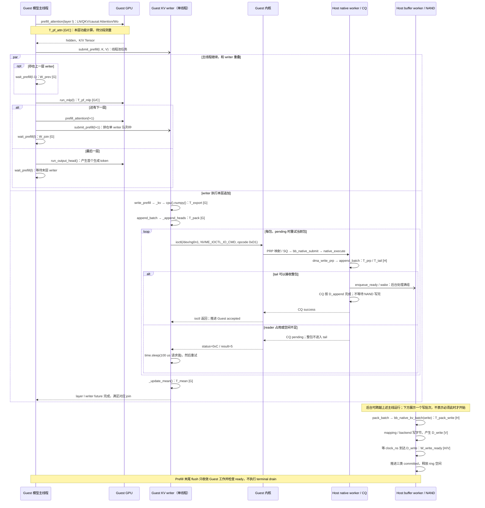
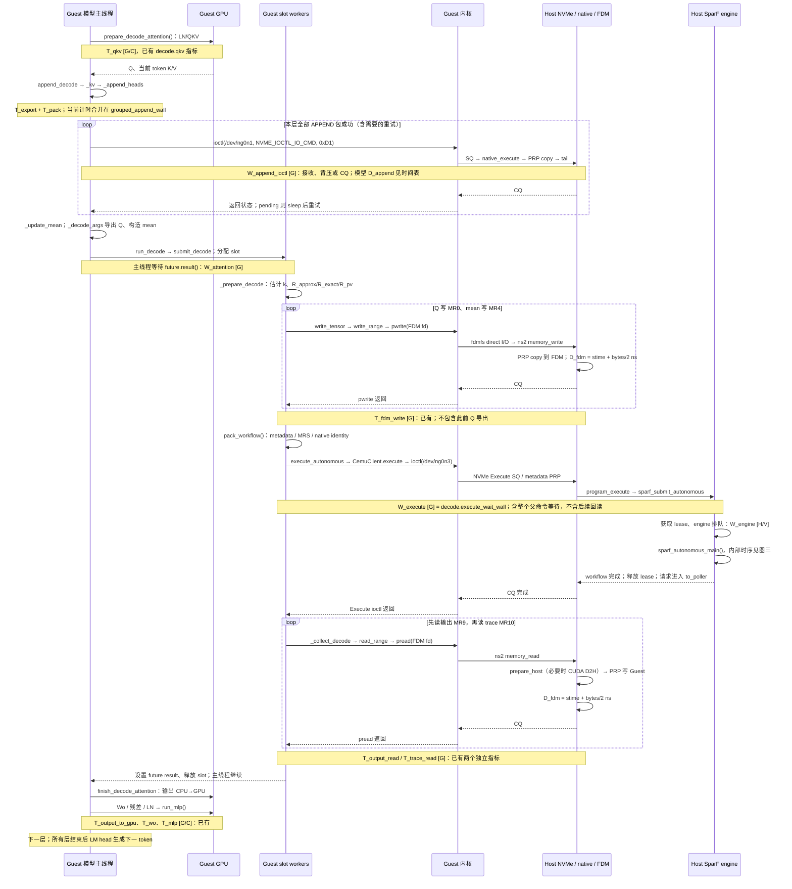
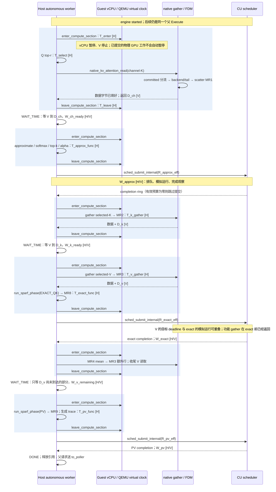

# Native InstAttention 串行路径时序图

2026-09-29，依据当前工作区。范围：functional、native KV、autonomous SparF、单 microbatch。这里没有开展新的性能测量；所有 T/W 均为待测区间，R/D 为当前模型预算或 deadline。图的纵向长度不代表耗时比例。

**推荐先看新版 [横向时间轴](figures/serial-timeline/README.md)**：完整生成与 Prefill、单层 Decode、一个历史 Execute 的按毫秒比例放大图。前两张标结构先后与待测区间；第三张使用独立历史日志，分别展示 Host 和虚拟时间，不与其他运行的 Guest 统计混用。

以下是原调用关系图（PNG 可直接插入文档，SVG 可无损放大）：

| 图 | PNG | SVG |
|---|---|---|
| Prefill | [图片](figures/serial-sequence/01-prefill.png) | [矢量图](figures/serial-sequence/01-prefill.svg) |
| 单层 Decode | [图片](figures/serial-sequence/02-decode-layer.png) | [矢量图](figures/serial-sequence/02-decode-layer.svg) |
| 父 Execute 内部 | [图片](figures/serial-sequence/03-execute-internal.png) | [矢量图](figures/serial-sequence/03-execute-internal.svg) |

重绘命令：`python3 figures/serial-sequence/render.py`（在本文目录执行）；脚本同时保存对应 `.mmd` 源码。

Guest 模型 Python 运行在 VM 中，Host 指 QEMU 所在的物理主机。slot 的 load/execute/store 实际为不同 workers，图二合并为一条逻辑生命线。GPU 箭头表示提交计算及取得所需结果，不表示每个 PyTorch 调用都主动同步 GPU。

## 时间标记

| 标记 | 时钟和含义 |
|---|---|
| G | Guest perf_counter：应用调用经过时间；尚不能认定自动扣除了 freeze |
| H | Host CLOCK_MONOTONIC：真实功能执行、锁和线程等待时间 |
| V | QEMU_CLOCK_VIRTUAL：设备模型时间，freeze 时不推进 |
| C | CUDA event：实际 GPU stream 区间，可包含等待 |
| T_x | 某一段调用/执行区间；未填实测值，不能当作已有独立模型 |
| W_x | 指定调用方阻塞等待的区间；可能嵌套其他 T/W，不能直接相加 |
| R_x / D_x | 配置/估算的计算预算 / 存储目标完成时刻，不是实际墙钟耗时 |

## 图一：Prefill 的生产、写入与后台写回

以下从某层 K/V 已产生开始，展示该层 writer 与主线程后续工作的并行。主线程可能一直走到下一层 Attention，再在该层的 writer join 点等待本层 writer；图中 par 两支只在这个 join 点汇合，不表示当前层 MLP 结束就必须等待本层 writer。首层没有上一层 writer；末层在输出头之后等待剩余 writer。



`time.sleep(100 us)` 是每次 pending 后的请求等待，不保证实际调度精确到 100 us。单 ioctl timeout=10 s；每包 pending 重试循环期限=120 s。这两个数是超时设置，不是正常延迟。

## 图二：一个 Decode 层，从 GPU 投影到下一层



FP16、B=4/H=40/d=128、128 KiB APPEND 能力的例子：一次 Decode 层提交 4 个 20 KiB KV 包；Q、mean、输出各 40 KiB。FDM 的 40 KiB 命令当前追加 `40960/2=20480 ns=20.48 us` 的模型延迟。这不是 syscall 实测耗时；驱动拆分、排队、拷贝和通知还需要分别观察。

## 图三：父 Execute 的功能执行、冻结和目标等待

每个蓝色区块概括一个阶段的功能工作。实际状态机可能为读结果收尾等短操作再次进入功能区；不是承诺一个阶段恰好一次 freeze。所有 `run_functional_modeling()` 调用都按 enter→功能→leave 执行。



目标计算预算与实际等待的关系：`R_i_eff = max(R_i - freeze_entry_i, 0)`（以各次生产调用实际值为准）。`freeze_entry` 是 Host 测量的进入功能区耗时，不是整段功能执行耗时。CU 等待还可能包含排队、切换和完成观察；不得将 `R_i` 标成整个 `W_i`。如果其他功能线程仍活跃，owner 的 leave 还会等待它们退出后才恢复 VM。

模型读剩余等待可按边界表达为 `max(0, D_read - V_enter_wait)`；轮询、线程唤醒可能晚于 deadline。每轮 `usleep(10)` 是请求 sleep 10 us，不是每次读只等待 10 us。冻结期间 Host H 继续推进、V 停止；Guest G 与 V 的关系需要单独核实，不能直接相减。

## “消耗多久、等待多久”当前可以填写到什么程度

| 图中区间 | 当前数值来源 / 公式 | 当前可观测性 |
|---|---|---|
| T_pf_attn / T_pf_mlp | GPU 实际执行，未在本文测量 | Prefill 有总量；单 microbatch 每层算子尚未接同一 profiler |
| T_qkv / T_output_to_gpu / T_wo / T_mlp | `decode.qkv/output_to_gpu/wo_norm_residual/mlp` 的 host_wall、cuda_stream | 已有，需启用 profile |
| T_export / T_pack / T_mean / W_append_ioctl | `prefill/decode.grouped_append_wall` 是整体包络 | 细项待拆；包含所有包和重试，不可再与细项相加 |
| APPEND 目标 CQ 时间 | `trans=max(10 ns, bytes/BW)`；`rx_next=max(rx_next,stime)+trans`；`D_append=rx_next+propagation` | 模型已有；实际 CQ 还受 poller 与 CQ 空间影响 |
| APPEND pending 重试 | 请求 sleep 100 us；单包循环期限 120 s，单 ioctl timeout 10 s | 重试次数已有；累计等待待独立计时。pending PRP 拷贝已执行，但不计成功包 PCIe 延迟 |
| T_pack_write / W_write_ready | 真实 pack/backend 成本 + 写入目标 deadline | 页/批次/字节统计已有；完整每批时间线待补 |
| T_fdm_write / T_output_read / T_trace_read | Guest syscall 区间；每个 FDM 命令额外模型延迟为 bytes/2 ns | 三项 Guest 指标已有；不能等同于模型延迟 |
| W_attention | 从准备请求到输出/trace 收集的整体等待，含 slot 获取与各 worker 调度 | `run_decode(...).result()` 路径明确；不是 execute_wait_wall 的别名 |
| W_execute | `decode.execute_wait_wall` | 已有 Guest 统计，包含图三及命令控制路径；不包含先前 Q/mean 上传和后续输出回读 |
| W_engine | engine started - admitted，分别用 H/V | Host autonomous timeline 已有事件，需启用 |
| D_ch / D_k / D_v 与读模型区间 | native NAND 调度：ready=max(各实际页的完成时间)，包含既有资源依赖；tail 不调用 NAND 读 | trace 已有三项 read_model_ns；Host timeline 有读边界，细分 gather 内部成本仍待补 |
| R_approx / R_exact / R_pv | metadata 中的 runtime 预算；R_eff 如上 | trace 已有 nominal；Host timeline 有 effective、CU spans、提交/完成事件 |
| T_approx_func / T_exact_func / T_pv_func | Host functional_start/end 差值 | 开启 Host timeline 可获取；approx 区间不含更早的 Q top-r |
| T_select / T_enter / T_leave | Host 功能/冻结控制成本，不是独立 FPGA 模型 | top-r、每次完整 enter/leave 仍需补齐关联事件；代码已有 freeze_entry 计算 |

以上均需按同一个 task/generation、step/token、layer、父请求关联。Guest PhaseProfiler 当前是聚合统计，不能单独还原每条请求；Host timeline 也不能代替所有 Guest 事件。图中阶段实际起止值应在统一运行中采集，不混用历史版本、不同形状的数据。

## 整次生成的终点

重复图二完成所有层和 Decode steps 后，执行 `BUFFER_DRAIN`：Guest `ioctl(/dev/ng0n1)` 通知后台把不足组的 tail 补零写出，pending 则重试，直到全部写目标完成且 sealed。`pipeline.final_flush_wall` 测该收尾屏障，不是最后一个 Execute 的内部阶段。Prefill、Decode、drain 的现有大区间分别为 `pipeline.prefill_wall`、`pipeline.decode_wall`、`pipeline.final_flush_wall`。

SparF trace 的名义合成式为：

```text
R_trace = R_channel_read + R_approx + R_token_k_read
        + max(R_exact, R_token_v_read) + R_pv
```

这不是 Guest W_execute 的恒等式，也不是包含所有排队/控制开销的实际父请求 V 区间。各时钟分别核算，重叠区间取并集；不得把 GPU、writer、背景写回、父 Execute 与其子段全部相加。

## 代码定位

- Prefill：[`ModelPrefillRunner.run`](python/runtime_common/prefill_runner.py)；writer 的提交/等待位于本层 Attention 后、MLP 前。
- Decode GPU 与回传：[`OptOperations`](python/opt_runtime/ops.py) 的 `prepare_decode_attention/finish_decode_attention/run_mlp`。
- KV 导出/均值：[`SparfGroupedAttentionBackend`](python/flexgen_adapter/sparf_attention.py) 的 `_kv/_append/_update_mean`。
- 分包/重试：[`NativeKvStore`](python/cemu_flexgen/native_kv_store.py) 的 `_append_heads/_call`；[`LinuxTransport`](python/native_kv_client.py) 构造 ioctl。
- Guest 三类 workers：[`CemuSparfSlotScheduler`](python/cemu_flexgen/cemu_sparf_slot_scheduler.py) 的 `_prepare/_autonomous/_collect`。
- FDM / Execute 系统调用：[`CemuClient`](guest/cemu_client.cpp) 的 `write_range/read_range/execute`。
- Guest 指标：[`CemuSparfDevice`](python/cemu_flexgen/cemu_sparf_device.py)、[`PhaseProfiler`](python/phase_profiler.py)。
- Host APPEND：[`native_execute`](../../../hw/femu/bbssd/instattention_native.c)、[`native_kv_buffer_append_batch/buffer_worker`](../../../hw/femu/bbssd/instattention_buffer.c)。
- PCIe / CQ：[`nvme_process_cq_cpl`](../../../hw/femu/nvme-io.c)；FDM：[`memory_read/write`](../../../hw/femu/csd/memory.c)。
- 冻结与自治等待：[`enter_compute_section/leave_compute_section/run_functional_modeling/sparf_autonomous_main`](../../../hw/femu/csd/compute.c)。
- 功能状态机：[`run_sparf_workflow`](../../../hw/femu/csd/sparf_workflow.h)；目标计算任务：[`sched_submit_internal`](../../../hw/femu/csd/sched.c)。

数据流详解：[NATIVE_SERIAL_DATAFLOW.md](NATIVE_SERIAL_DATAFLOW.md)；物理阶段对应：[PHYSICAL_STAGE_MAPPING.md](PHYSICAL_STAGE_MAPPING.md)。
